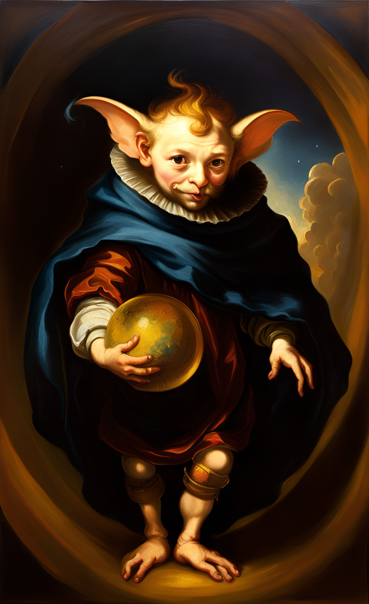

# Qimp


<div align="center">

[](https://pypi.python.org/pypi/qimp)
[](https://pypi.python.org/pypi/qimp)
[](https://github.com/Giacomo-Antonioli/qimp/actions?workflow=tests)
[](https://codecov.io/gh/Giacomo-Antonioli/qimp)
[](https://qimp.readthedocs.io/)
[](https://pypi.python.org/pypi/qimp)

[](https://github.com/psf/black)
[](https://github.com/pre-commit/pre-commit)
[](https://www.contributor-covenant.org/version/2/0/code_of_conduct/)

</div>



Quantum image manipulation package and Qiskit circuit wrapper.


* GitHub repo: <https://github.com/Giacomo-Antonioli/qimp.git>
* Documentation: <https://qimp.readthedocs.io>
* Free software: MIT


## Features

* `QuantumImage` prepares NumPy image arrays, including padding and optional zooming.
* FRQI encoding converts pixel intensity into controlled-RY rotations.
* NEQR encoding represents each pixel value with eight color qubits.
* The package includes arithmetic and translation gates and an experimental Sobel filter.

QImP is a **pre-alpha / experimental** project. Encoding and image-construction APIs are
present and covered by tests, while filtering and the example script should be treated as
in-development. The package targets Python 3.9 through 3.11.

## Quickstart

Install the package with Poetry:

```console
$ poetry install
```

Create and encode a generated square image:

```python
from qimp.ImageEncoding.Encodings import FRQI
from qimp.ImageEncoding.QuantumImage import QuantumImage, generate_example_image

image = QuantumImage(generate_example_image(side=8), zooming_factor=1)
FRQI(image)

print(image.circuit)
```

NEQR encoding is available through the same image object:

```python
from qimp.ImageEncoding.Encodings import NEQR

image = QuantumImage(generate_example_image(side=8))
NEQR(image)
```

Run the demonstration script with `poetry run python src/qimp/main.py`. It is experimental
and uses a million-shot retrieval configuration.

## Development

Install the development tools and Git hooks:

```console
$ poetry install
$ poetry run pre-commit install
```

Run all configured hooks at any time with:

```console
$ poetry run pre-commit run --all-files
```

Run the targeted test suite directly with pytest:

```console
$ poetry run pytest tests
```

The repository Invoke and Nox tasks provide additional checks:

```console
$ poetry run inv tests
$ nox -s tests-3.11
$ nox -s mypy-3.11
```

## Credits

This package was created with [Cookiecutter][cookiecutter] and the [fedejaure/cookiecutter-modern-pypackage][cookiecutter-modern-pypackage] project template.

[cookiecutter]: https://github.com/cookiecutter/cookiecutter
[cookiecutter-modern-pypackage]: https://github.com/fedejaure/cookiecutter-modern-pypackage
